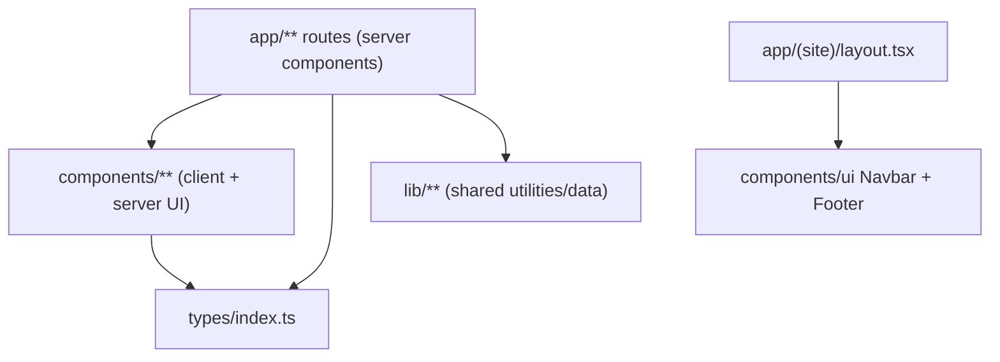

# architecture.md — how this project is built

System-level map of the My Study Hub website. For *where files live* read
[details.md](details.md); for *per-file implementation detail* open the
`AGENT_CONTEXT.md` in the folder you are about to touch. This file consolidates
and supersedes the previous `Architecture.md` (renamed), verified against the
working tree at the time of writing.

## 1. Overview

My Study Hub is a content-heavy marketing website for an MBBS-abroad
admissions consultancy, with a small, partly unfinished admin placeholder.
Almost everything is static, presentational React. There is **no CMS, no public
API and no server action** in the repository today — editorial content (blogs,
brochures, events, universities, team, testimonials) is hard-coded in
components/page files.

- **Framework:** Next.js 16.3.8 (App Router, Turbopack), React 19.2.8.
- **Language:** TypeScript 5, `strict: true`, path alias `@/*` → repo root.
- **Styling:** Tailwind CSS v4 (`@tailwindcss/postcss`), utility classes plus
  inline styles copied from Figma values; global CSS in `app/globals.css`.
- **UI libs:** `lucide-react` icons, `class-variance-authority`, `clsx`,
  `tailwind-merge` (wrapped by `lib/utils.ts#cn`).
- **Backend:** No database or external application backend is currently used.
- **Tooling:** ESLint (`eslint-config-next`), npm scripts (see §10). A
  dependency-graph generator (`npm run graph`) is referenced but its script
  `tools/graph.mjs` is absent from the working tree.

> Next.js 16 has breaking changes. Read the bundled docs in
> `node_modules/next/dist/docs/` before writing Next-specific code.

## 2. Directory responsibilities

```
app/                 Routes only. Pages compose sections; no business logic.
  layout.tsx         Root layout: Geist fonts, Navbar, <main>, Footer (wraps admin too)
  page.tsx           "/" — stacks components/homepage sections
  globals.css        Tailwind import, Google-font @import, theme tokens, body bg
  (site)/            Route group (no URL segment): all public pages
  admin/             Empty admin placeholder
components/          All UI, one folder per feature (86 .tsx files, 16 folders)
  ui/                Shared primitives: Navbar, NavDropdown, Footer, PageBanner, Button, form, ...
  homepage/          19+ sections of "/"; some reused by other pages
  about-us, services, contact-us, career, partner-with-us, collections,
  brochures, blogs, blog-details, images, videos, countries(+mbbs-russia), admin
lib/                 Shared registries, constants and utilities
types/index.ts       Shared interfaces (mostly aspirational — see §6)
scripts_ts/          Standalone Node CLIs: create-admin.ts, dev-db.ts
tools/               search.sh (npm run find); graph.mjs is MISSING
public/              196 static assets; public/AGENT_CONTEXT.md is the asset blueprint
```

## 3. Layering



Rules implied by the implementation:

- `app/**` may import `components/**`, `lib/**`, `types/**`.
- `components/**` may import the framework-free helpers in `lib/**`.
- `lib/**` imports nothing from `app/` or `components/`.
- No import cycles are intended. Known exception:
  `components/ui/Navbar.tsx ↔ NavDropdown.tsx` (NavDropdown imports `bgColor`
  from Navbar).
- Cross-feature reuse exists and is easy to break:
  `about-us/ContactSection` ← contact page, `about-us/lastsection` ←
  partner-with-us, `homepage/ExpertCounsellingSection` ← about-us,
  `homepage/MeetOurTeam` ← about-us, `images/EventContactForm` ← Russia page.

## 4. Routing and rendering

`app/(site)` is a route group: it contributes no URL segment and owns the
public Navbar/Footer/main shell. The root layout only supplies the document,
fonts, and global styles, so auth and admin routes do not receive site chrome.

| Area | Routes | Rendering |
|---|---|---|
| Public | `/`, `/about-us`, `/about-us/career`, `/about-us/partner-with-us`, `/about-us/services`, `/collections`, `/collections/blog`, `/collections/blog/[slug]`, `/collections/brochures`, `/collections/upcoming-event`, `/contact-us`, `/countries`, `/countries/mbbs-in-russia`, `/gallery` (redirect → `/gallery/images`), `/gallery/images`, `/gallery/images/[slug]`, `/gallery/videos`, `/web-stories` | Page files are server components that render mostly `"use client"` section components. Statically prerendered unless they touch cookies. |

Details verified in the tree:

- `/about-us` is special: `app/(site)/about-us/page.tsx` re-exports the default
  export and metadata from `components/about-us/page.tsx`.
- Metadata is exported per page, but `/` (homepage) falls back to the root
  layout title; `/countries`, `/collections/blog/[slug]`,
  `/gallery/images/[slug]` and the redirecting `/gallery` export none.
- Dynamic routes: `blog/[slug]` awaits `params` (Next 16 async params) but
  renders one hard-coded article for every slug; `gallery/images/[slug]`
  accepts any slug and does not pass it to the section components.
- `/gallery` calls `redirect()` (307) to `/gallery/images`.
- Missing routes referenced by UI: `/countries/mbbs-in-<slug>` (12 of 13),
  `/colleges/<slug>`, `/admin`.

### Public request lifecycle

```mermaid
sequenceDiagram
  participant B as Browser
  participant N as Next.js (App Router)
  participant L as app/layout.tsx + app/(site)/layout.tsx
  participant P as page.tsx
  participant C as components/<feature>
  B->>N: GET /path
  N->>L: render root document layout
  N->>L: render site layout (Navbar, main, Footer)
  N->>P: render route segment
  P->>C: compose sections (server + client components)
  C-->>B: HTML + RSC payload; client components hydrate
```

## 5. Data architecture

- **Content:** hard-coded arrays/objects inside page and component files
  (blogs, brochures, events, videos, universities, jobs, testimonials, team
  members, gallery items). Several datasets are duplicated across files (e.g.
  `BlogsGrid`, `RelatedBlogs`, blog detail page).
- **Types:** `types/index.ts` defines the intended domain model
  (`BlogPost`, `University`, `EventItem`, `JobOpening`, `BrochureItem`, …) but
  only `TeamMember` is imported anywhere — the data is not typed against them.
- **Database:** none. No public data is persisted.

## 6. Concurrency and shared state

Next.js serves many requests from one Node process and hot-reloads modules in
development, so module scope is shared.

- Layouts do not re-render on client-side navigation: auth checks must live in
  every page/server action, never only in a layout.
- Do not add module-level mutable singletons in `components/**` or `lib/**`;
  per-request data must come from props, `cookies()`, or the database.
- Prefer atomic DB updates (`$inc`, `$set`) over read-modify-write.

## 7. Presentation conventions

- One section per file, default export, PascalCase `.tsx`, kebab-case folders.
- Most sections are `"use client"` (57 of 86 components) because they use
  state, effects or hover handlers; purely presentational ones remain server
  components.
- Styling is a mix of Tailwind utilities and inline `style` objects carrying
  Figma values (`clamp()` typography, gradient text via
  `backgroundClip: "text"`). Google fonts are loaded with a CSS `@import` in
  `app/globals.css`; `app/layout.tsx` loads Geist through `next/font` but the
  theme actually uses Inter.
- Images: local files under `public/` referenced as `/folder/file.ext`, plus
  remote hosts allow-listed in `next.config.ts` (unsplash, flagcdn, figma).
  Image inventory and per-file usage: `public/AGENT_CONTEXT.md`.

## 8. Configuration and entry points

| Entry point | Role |
|---|---|
| `app/layout.tsx` | Root document layout and `<html>`/`<body>` |
| `app/(site)/layout.tsx` | Public Navbar, main shell and Footer |
| `app/(site)/page.tsx` | Homepage composition |
| `app/(site)/**/page.tsx` | Public routes |
| `app/admin/**` | Empty admin placeholder |

Configuration files: `next.config.ts` (image hosts, devIndicators off),
`tsconfig.json` (strict, `@/*`), `eslint.config.mjs`, `postcss.config.mjs`,
`.env.example` (currently informational only).

## 9. Tooling

| Command | State | What |
|---|---|---|
| `npm run dev` / `build` / `start` | works | Next scripts; `build` is the de-facto type-check |
| `npm run lint` | works | ESLint |
| `npm run find -- <name>` | works | `tools/search.sh`, case-insensitive filename search |
| `npm run graph` | **broken** | points at missing `tools/graph.mjs`; `graph/` does not exist |
| `npm run graph:check` | **broken** | same missing script |

Because the graph generator is missing, every `AGENT_CONTEXT.md` in the tree is
hand-maintained. When adding/moving/renaming a source file, update the
`AGENT_CONTEXT.md` of its directory manually.

## 11. Known gaps and risks (verified in the working tree)

1. Blog system is display-only: all card links are `#`, `[slug]` ignores the
   slug, no `generateStaticParams`, no `notFound()`.
2. `Gallery images/[slug]` is a soft 404: any slug renders the same content.
3. Brochures have `fileUrl: "#"`; no downloads work.
4. Many CTAs/buttons have no `href`/`onClick` (homepage, career, partner pages).
8. `PageBanner` default image `/bd-doctor.jpg` does not exist (call sites pass
   their own).
9. Stale/invalid Tailwind utilities appear in places (`h-[60]`, `sm:75`,
   `insert-0`, dynamic `h-${size}` classes) and silently do nothing.
10. `components/ui/Faq.tsx` and `lib/constants.ts#gradientTextStyle` are unused;
    several `public/` assets are unreferenced (see `public/AGENT_CONTEXT.md`).

## 12. Documentation map

- `architecture.md` (this file): system structure and cross-cutting rules.
- `details.md`: folder tree and “where do I change X”.
- `decisions.md`: decision log (D-001…).
- `AGENTS.md`: non-negotiable agent rules (Next 16 docs, graph usage, state
  rules).
- `*/AGENT_CONTEXT.md`: file-by-file implementation notes for that directory.
