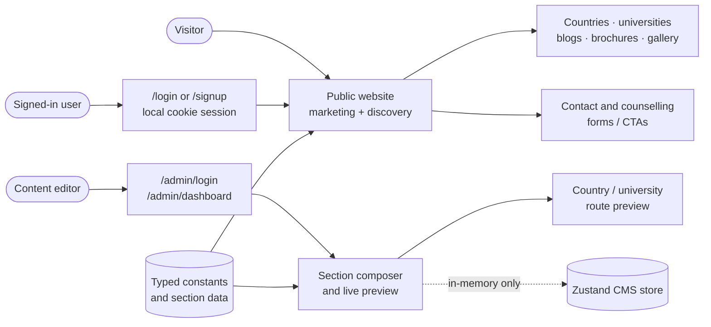
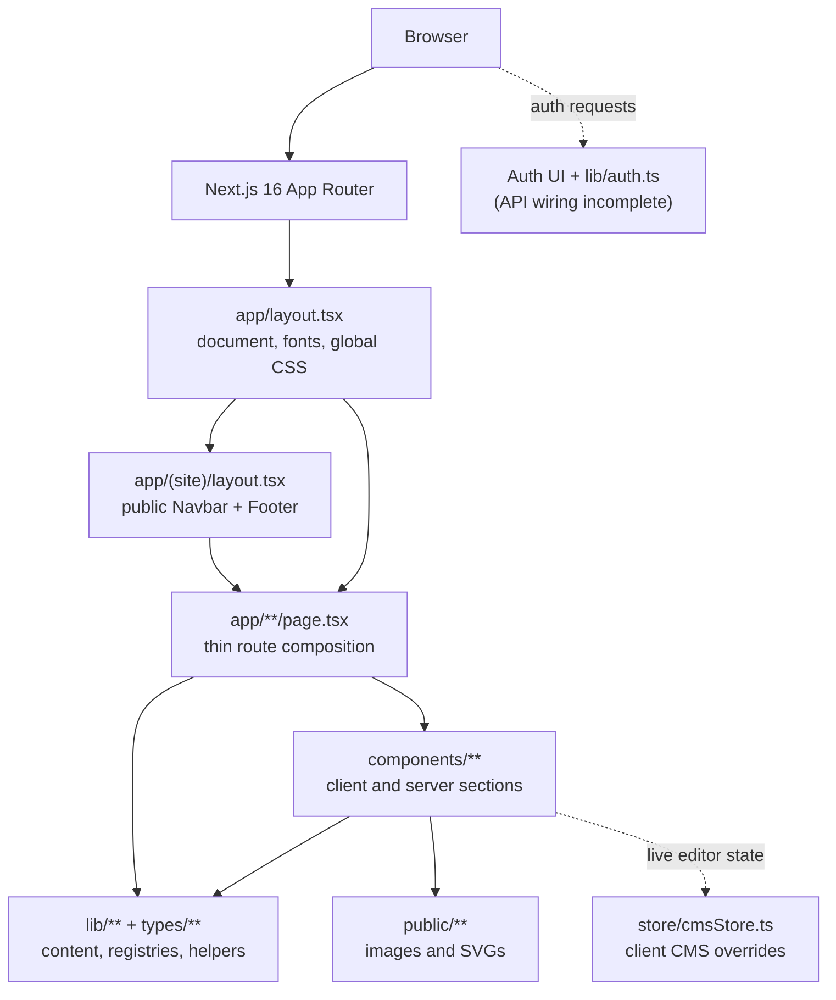
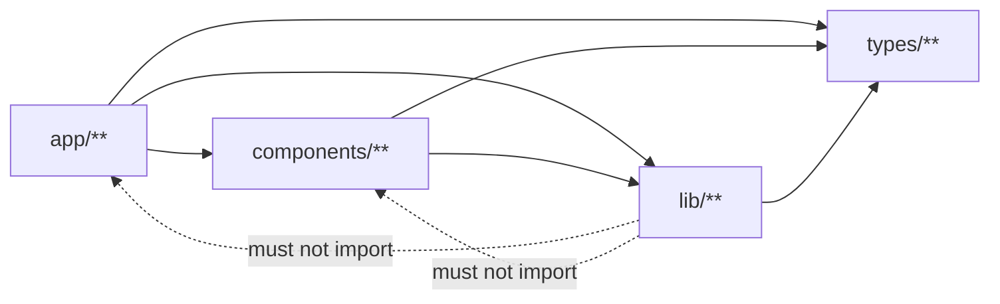
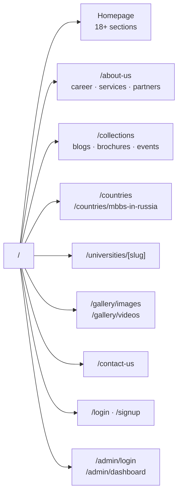
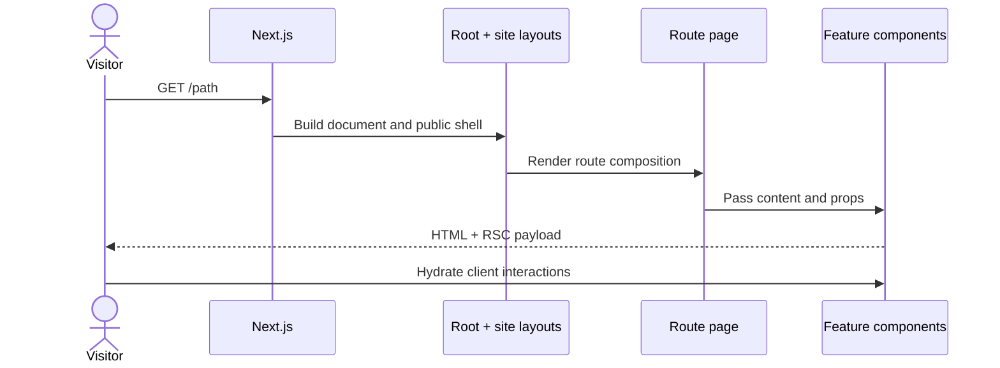
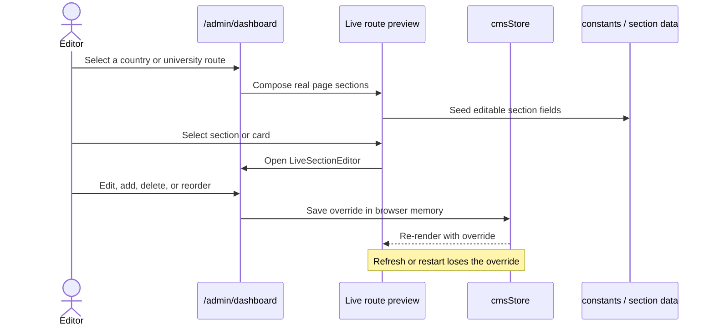
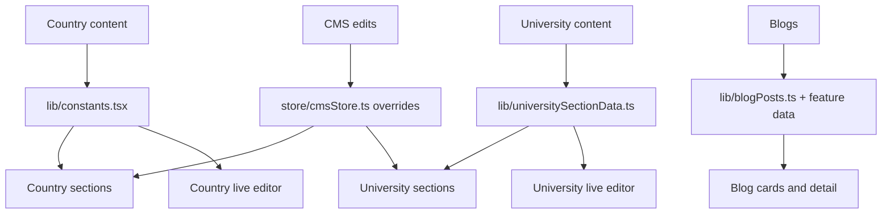

# My Study Hub — architecture at a glance

This is the visual guide to the My Study Hub website. It explains what runs
where, how content moves through the app, and which parts are intentionally
not persistent yet.

- **Where should I edit something?** See [details.md](details.md).
- **How does a user or editor move through the product?** See [flow.md](flow.md).
- **Why was a design chosen?** See [decisions.md](decisions.md).
- **What does each file do?** Open the nearest `AGENT_CONTEXT.md`.

## 1. Product in one picture

### The important boundary

The public website is primarily a static presentation layer. The CMS can
change the client-side preview, but those changes are not saved to a database
or published to visitors after a refresh.

| Area | Current responsibility | Persistence |
| --- | --- | --- |
| Public pages | Present marketing, country, university, blog, brochure, event and gallery content | Source files / typed constants |
| Public auth UI | `/login` and `/signup` forms | Current form wiring posts to `/api/admin/login`; public auth handlers are not present in the current tree |
| Admin CMS | Compose sections and edit cards in a live route preview | Zustand state in the browser only |
| Backend | Small auth and admin/university API surfaces where present | No general public content API |

## 2. Runtime layers

### Import rules

- Routes compose pages; business and presentation logic belongs below them.
- Shared helpers in `lib/` stay framework- and UI-independent.
- Do not add module-level mutable state in `app/`, `components/`, or `lib/`.
- Auth checks belong on every protected page or server action, not only in a
  layout.
- The known `Navbar.tsx` ↔ `NavDropdown.tsx` import cycle is an existing
  exception and should not be expanded.

## 3. Route map

| Route group | Shell | Rendering shape | Main source |
| --- | --- | --- | --- |
| Public `(site)` | Navbar, `<main>`, Footer | Server route + mostly client sections | `components/<feature>/` |
| Auth `(auth)` | Root document only | Client auth form + auth API | `components/auth/`, `lib/auth.ts` |
| Admin | Root document only | Client dashboard and CMS preview | `components/cms/`, `store/cmsStore.ts` |

The `(site)` folder is a route group, so it does not add a URL segment.
`/gallery` redirects to `/gallery/images`. Dynamic blog and gallery slugs
currently render permissive placeholder/detail content rather than validated
records.

## 4. Request and content lifecycles

### Public page request

### CMS live-edit loop

## 5. Content ownership map

**Card rule:** country and university cards are represented as serializable
records and edited through the shared CMS card editor. New cards use the
section template; legacy pipe-delimited values are still parsed for backwards
compatibility.

## 6. Rendering and styling conventions

- Components are functional, default-exported PascalCase `.tsx` files.
- Feature folders use kebab-case; dynamic routes use `[slug]`.
- `@/*` resolves to the repository root.
- Tailwind CSS v4 utilities are combined with inline Figma-derived values.
- Local media belongs in `public/<feature>/` and is referenced with
  `/feature/file.ext`.
- Most interactive sections are `"use client"`; route files should remain
  thin.

## 7. Known gaps (important when reading the diagrams)

1. The CMS is a client-side editing preview, not a publishing system.
2. Blog cards and brochure links are display-only in several places; brochure
   downloads currently use `#`.
3. Blog and gallery dynamic slugs are not validated with `notFound()`.
4. Several UI CTAs do not yet have a destination or handler.
5. Many country links refer to route patterns that do not exist yet.
6. `tools/graph.mjs` is missing, so `npm run graph` and
   `npm run graph:check` are currently unavailable.
7. Some stale Tailwind utilities and an unused default `PageBanner` asset
   reference are documented in the existing implementation notes.

## 8. Verification commands

| Command | Purpose | Current state |
| --- | --- | --- |
| `npm run dev` | Local development | Supported |
| `npm run build` | Production build and type check | Supported |
| `npm run lint` | ESLint | Supported |
| `npm run find -- <name>` | Case-insensitive filename search | Supported |
| `npm run graph` | Rebuild dependency documentation | Blocked by missing `tools/graph.mjs` |
| `npm run graph:check` | Check dependency documentation freshness | Blocked by missing `tools/graph.mjs` |
