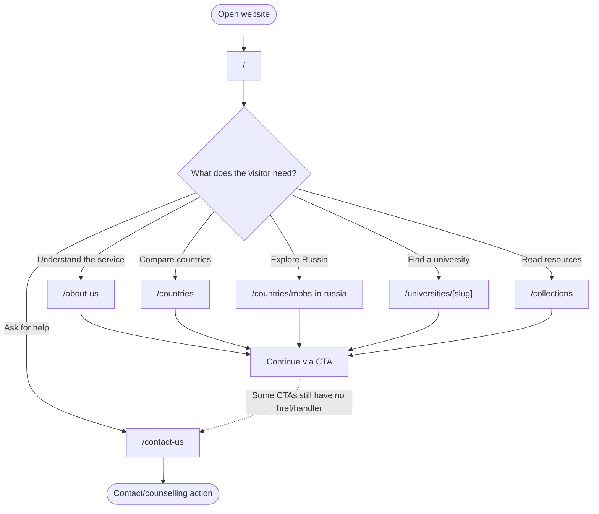
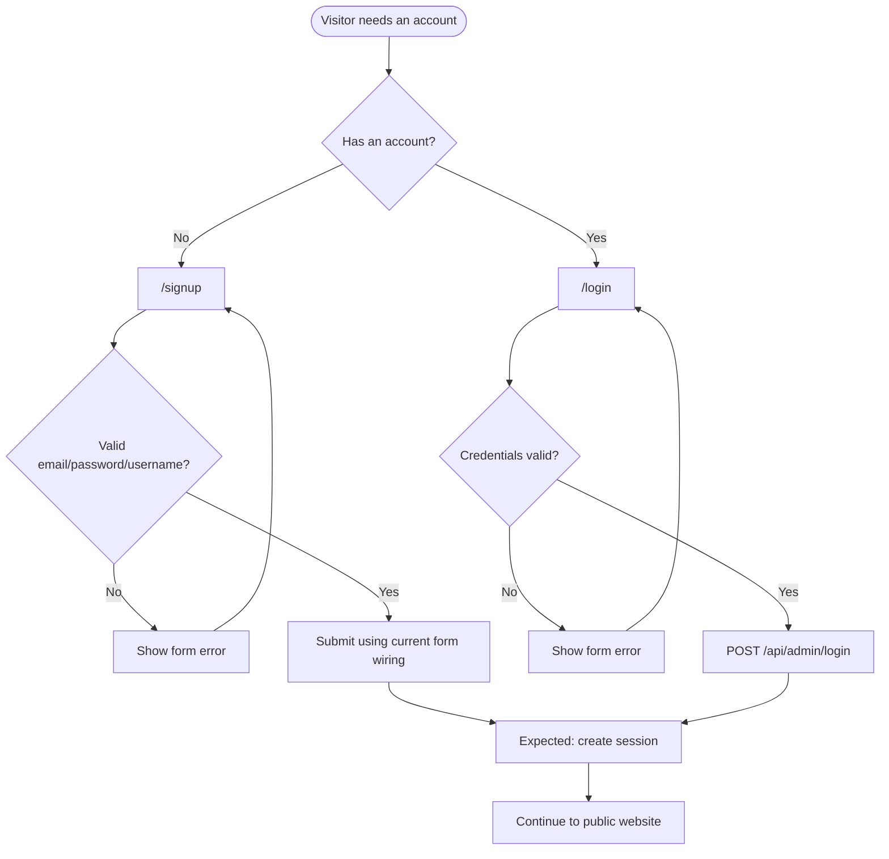
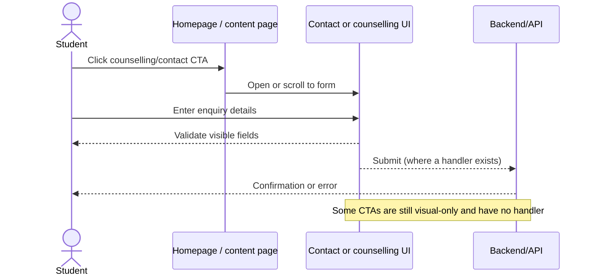
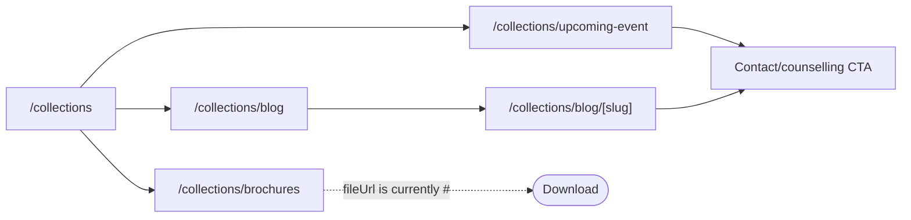
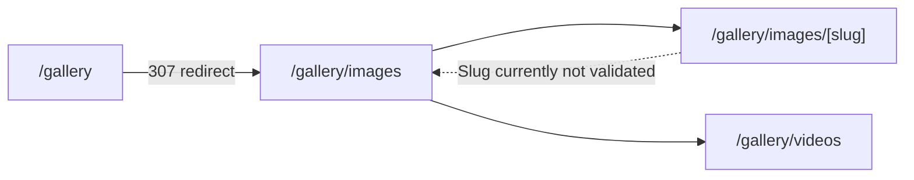
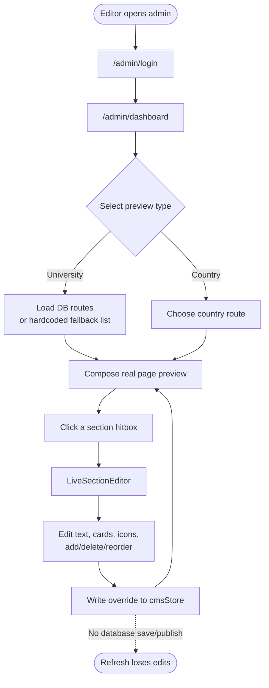
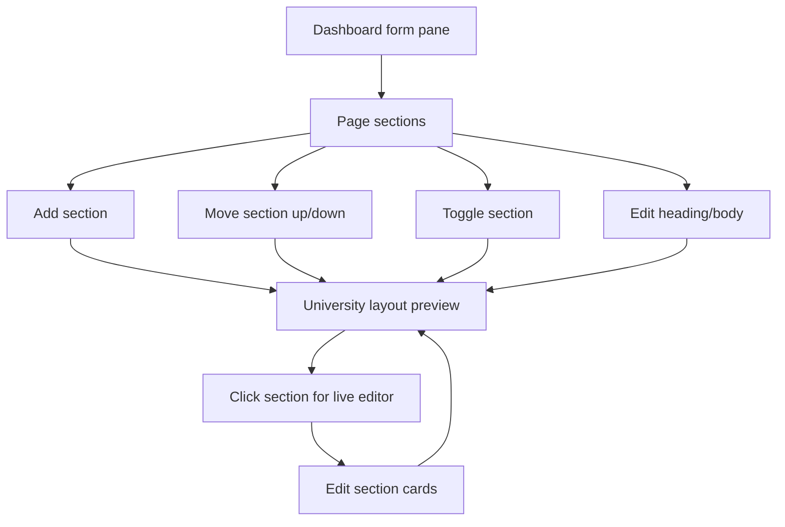
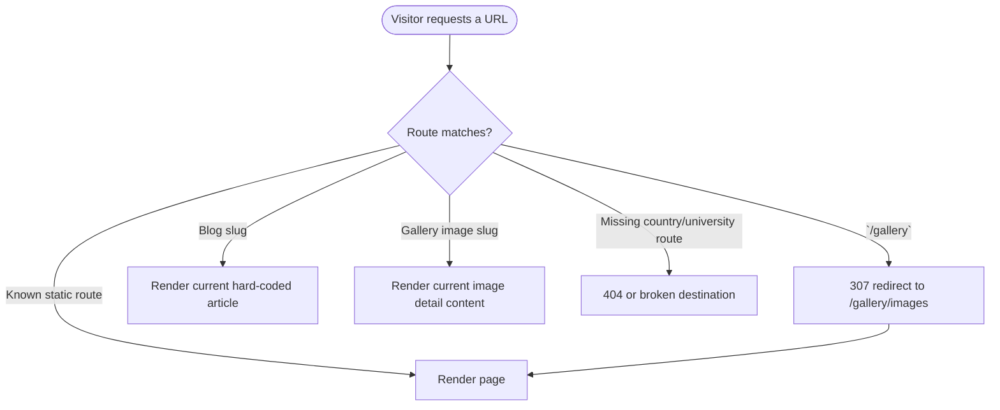

# My Study Hub — user flows

This document describes the main journeys through the current website. Solid
arrows are implemented navigation or state changes. Dashed arrows indicate a
known placeholder, client-only behavior, or a gap to address later.

## Flow index

| Flow | Primary user | Entry points | Outcome |
| --- | --- | --- | --- |
| [1. Discover and explore](#1-discover-and-explore) | Prospective student | `/`, Navbar, search UI | Finds a country, university or resource |
| [2. Signup and login](#2-signup-and-login) | Returning/new user | `/signup`, `/login` | Completes the currently wired form path |
| [3. Request counselling](#3-request-counselling) | Prospective student | Homepage and contact CTAs | Reaches a contact form or counselling section |
| [4. Read content](#4-read-content) | Any visitor | Collections and gallery | Reads a blog, brochure/event or views media |
| [5. Edit a live route](#5-edit-a-live-route) | Content editor | `/admin/dashboard` | Sees an in-memory CMS preview |
| [6. Build page sections](#6-build-page-sections) | Content editor | Admin section composer | Reorders/toggles sections in a preview |
| [7. Redirect and fallback behavior](#7-redirect-and-fallback-behavior) | Any visitor | Legacy or dynamic URL | Is redirected or shown permissive content |

## 1. Discover and explore

**Notes**

- The homepage is a composition of many client-side sections.
- The site Navbar and Footer are provided by `app/(site)/layout.tsx`.
- Search visuals exist, but search does not currently represent a complete
  cross-site results workflow.

## 2. Signup and login

**Current state:** the forms exist, but their current submit handler posts to
`/api/admin/login`; that route is not present in the current tree. Signup and
public session completion should therefore be treated as an integration gap,
not a completed user flow.

## 3. Request counselling

When implementing a missing CTA, keep the destination explicit: use a real
`href` for navigation or a clearly surfaced form submission error. Do not
silently treat a placeholder as a successful enquiry.

## 4. Read content

### Blog, brochure and event journey

### Gallery journey

## 5. Edit a live route

The editor seeds fields from `lib/constants.tsx` for countries and from
`lib/universitySectionData.ts` for universities. The shared card editor keeps
card data serializable so the preview can render the same shape that the
editor changes.

## 6. Build page sections

This is a composition workflow, not a publishing workflow. A future
persistence layer should define authentication, validation, draft state,
publish state and conflict handling before replacing the in-memory store.

## 7. Redirect and fallback behavior

The dynamic blog and gallery routes currently accept broad slug values rather
than calling `notFound()`. Treat this as a known product gap when adding links
or analytics around those journeys.

## Flow design checklist

When adding a new journey:

1. Start it at a real route or an explicit button/link.
2. Show loading, validation and failure states where a request can fail.
3. Decide whether the result is static, client-only, or persisted.
4. Add the journey to this file and update the route map in
   [architecture.md](architecture.md).
5. Keep route composition in `app/` and feature behavior in
   `components/`, `lib/`, or `store/`.
